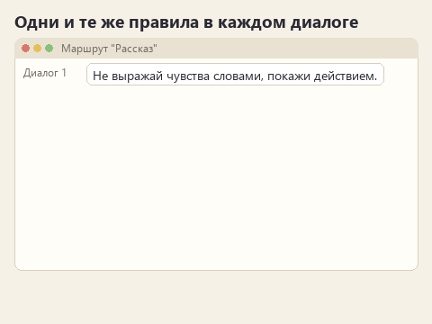
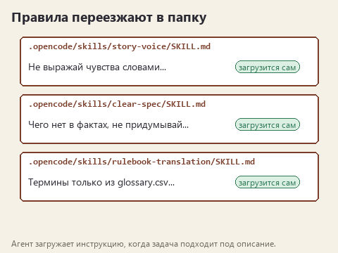

# Писательские навыки ИИ

Автор пишет цикл рассказов о старом смотрителе маяка и третий вечер подряд объясняет модели одни и те же правила. Первое: чувства героя в цикле не выражаются словами. Смотритель получает письмо от дочери, которая четыре года ему не писала, и в тексте нет слов "ему стало тоскливо". Он убирает конверт в ящик стола, так и не распечатав, и читатель сам понимает, каково ему. Второе: действие происходит в 1974 году, телефона на острове нет. Модель извиняется и переписывает сцену как надо, а в новом диалоге снова вставляет "сердце сжалось" и звонок с материка.

Аналитик просит набросать раздел ТЗ по заметкам со звонка. Через минуту в разделе стоит "система выдерживает нагрузку в 1000 одновременных пользователей". Заказчик эту цифру не называл, но подрядчик прочитает её как требование и заложит в оценку.

Переводчик сдаёт страницу правил настольной игры. В первом абзаце "жетоны масла", во втором уже "токены", а вежливое "вы" из брифа издателя превратилось в "ты". Глоссарий модель видела, но помнит о нём, только пока он лежит перед глазами.

У всех троих одна беда: правила работы приходится повторять в каждом диалоге, и стоит одно забыть, как ошибка возвращается. Скилл решает именно это. Правила лежат в папке рядом с проектом, и агент сам загружает их, когда видит подходящую задачу. За этот курс вы соберёте такую папку для одной из трёх ситуаций, по одному правилу за урок, и каждое правило проверите на настоящем ответе модели.

Статичный вариант

## Скилл в двух словах

Скилл - это папка, например `.opencode/skills/story-voice/`. В ней лежит файл `SKILL.md`: в шапке имя и описание, ниже инструкция для модели. Рядом можно положить справки с образцами и небольшие программы для проверки. Приложение показывает модели только имя и описание каждого скилла. Когда задача подходит под описание, модель загружает инструкцию целиком, а справки читает по необходимости.

Подробно про устройство написано в статье [Как устроен скилл](how-a-skill-works.md). Для начала этого достаточно, к статье удобно вернуться перед вторым уроком.

## Выберите маршрут

Механика уроков общая, отличаются тексты и правила. Берите тот маршрут, который ближе к вашей работе. Папки всех трёх лежат в каждом архиве, так что второй маршрут можно пройти потом.

| Маршрут | С каким текстом работаем | Что модель делает без скилла | Какой скилл соберёте |
|---|---|---|---|
| Рассказ | Черновик сцены из цикла о смотрителе маяка и канон цикла | Выражает чувства словами, добавляет штампы, забегает вперёд сюжета | `story-voice` |
| ТЗ | Заметки после звонка с сетью пекарен и список подтверждённых фактов | Придумывает цифры, пишет "быстро и удобно", выдаёт нерешённое за решённое | `clear-spec` |
| Перевод | Страница правил настольной игры, бриф издателя и глоссарий | Путает термины, переходит на "ты", переводит идиомы дословно | `rulebook-translation` |

Сцена, пекарни и игра придуманы для курса. Чем они похожи на ваши настоящие задачи, вы заметите уже в первом уроке.

## Карта курса

| Урок | Что делаете | Что у вас остаётся |
|---|---|---|
| [0. Ставим OpenCode](lesson-00-setup.md) | Устанавливаете приложение, выбираете бесплатную модель и маршрут | Модель отвечает в папке вашего маршрута |
| [1. Без скилла](lesson-01-baseline.md) | Отправляете задачу как есть и заранее угадываете, где модель ошибётся | Первый ответ и список конкретных промахов |
| [2. Первое правило](lesson-02-first-skill.md) | Пишете `SKILL.md` с одним правилом | Скилл, загрузку которого видно в истории |
| [3. Проверяемое правило](lesson-03-checkable-rule.md) | Превращаете пожелание "пиши лучше" в правило с понятным признаком | Два ответа, которые отличаются одним изменением |
| [4. Справка](lesson-04-references.md) | Выносите образцы в отдельный файл | Агент читает справку тогда, когда она нужна |
| [5. Скрипт проверки](lesson-05-checks.md) | Подключаете проверку слов и оборотов | Отчёт скрипта и ошибка, которую замечаете только вы |
| [6. Перенос](lesson-06-transfer.md) | Даёте скиллу новый текст, чужой текст и новый проект | Переносимая папка с понятными границами |
| [Заключение](conclusion.md) | Сравниваете свою версию с готовой и решаете, какой скилл собрать для себя | План собственного скилла |

Каждый урок занимает примерно полчаса. Ответы модели будут отличаться от моих примеров и от ответов других учеников: это нормально, мы сравниваем их по списку признаков, а не по совпадению слов. Как ставить такие опыты, разобрано в статье [Как ставить опыт с моделью](experiments.md).

## Что понадобится

Компьютер с Windows, приложение OpenCode Desktop и Блокнот. Программировать не придётся: в пятом уроке будет готовый скрипт, и его можно запустить прямо в браузере. Платная подписка тоже не нужна. В каталоге OpenCode на 21.10.2026 были бесплатные модели; условия меняются, поэтому в нулевом уроке мы первым делом проверим, что модель отвечает.

Анимации в уроках нарисованы для курса и показывают порядок действий. Настоящий экран и ответы модели у вас будут свои.

## Справка по ходу курса

- [Как устроен скилл](how-a-skill-works.md) - из чего состоит папка и как инструкция доходит до модели.
- [Как ставить опыт с моделью](experiments.md) - одно изменение за раз и честное сравнение ответов.
- [Готовые промпты](prompts.md) - запросы для работы с готовыми скиллами и для сборки своего.
- Готовые скиллы всех трёх маршрутов: [story-voice](../downloads/story-voice.zip?raw=true), [clear-spec](../downloads/clear-spec.zip?raw=true), [rulebook-translation](../downloads/rulebook-translation.zip?raw=true). С ними удобно сверяться после шестого урока.

Начинаем с [нулевого урока](lesson-00-setup.md).
