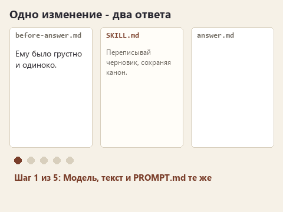
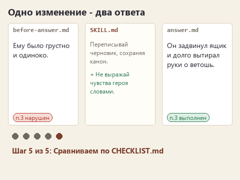

# Как ставить опыт с моделью

Аналитик добавил в скилл правило "не придумывай цифры", отправил запрос и получил раздел ТЗ без единой выдуманной цифры. Правило сработало? Не обязательно. Возможно, модель и в прошлый раз обошлась бы без них, просто повезло. А возможно, аналитик заодно поменял формулировку запроса, и помогла именно она.

Ответы модели меняются от запуска к запуску, поэтому впечатление "стало лучше" легко обманывает. В курсе мы держимся нескольких договорённостей, которые помогают отличить сработавшее правило от удачного случая.

## Одно изменение за раз

Между двумя запусками меняется что-то одно: правило в `SKILL.md`, справка или скрипт. Модель, исходный текст, факты и текст `PROMPT.md` остаются прежними. Если поменять сразу правило и модель, разница в ответах не скажет, что из двух помогло.

Перед правкой сохраните текущий ответ: в Проводнике скопируйте `results/answer.md` и назовите копию `results/before-answer.md`. После правки новый `answer.md` будет с чем сравнить.

Статичный вариант

## Новый диалог для каждого запуска

Внутри одного диалога модель помнит ваши прошлые замечания. Если в нём вы уже трижды написали "не выражай чувства словами", четвёртый ответ без чувств, выраженных словами ничего не говорит о скилле. Поэтому каждый запуск начинаем кнопкой **New session**.

## Признаки до отправки

В каждой папке маршрута лежит `CHECKLIST.md` - шесть конкретных признаков, по которым мы оцениваем ответ. Например, для сцены: "Ильич не открыл письмо". Для перевода: "нет токенов и фишек". Прочитайте его до отправки и запишите в `results/observations.md` догадку: какой пункт модель нарушит. После ответа вернитесь к догадке. Так видно, насколько хорошо вы уже понимаете поведение модели, и это заметно интереснее, чем просто читать ответ.

Оценивайте по признакам, а не по общему впечатлению. Запись "стало живее" через неделю ничего вам не скажет. Запись "пункт 3: было "ему стало грустно", теперь "он долго вытирал руки о ветошь"" покажет и правило, и результат.

## Загрузку проверяем по истории

Агент может написать "я использовал скилл story-voice", даже если не загружал его. В истории работы OpenCode каждый вызов инструмента виден отдельной строкой. Разверните строку `skill` и посмотрите, что за текст пришёл. Для справки ищите отдельное действие чтения файла `references/...`. Если действия нет, правило до модели не дошло, сколько бы агент ни уверял.

## Один удачный ответ ещё не вывод

Если правило важно, отправьте тот же запрос два-три раза в новых диалогах и проверьте те же признаки. Не выбирайте самый удачный ответ. Если из трёх ответов два нарушают пункт, правило нужно уточнять, даже если третий получился прекрасным.

И наоборот: если модель с первого раза справилась без скилла, это нормальный результат. Запишите его. Тогда правило в скилле будет страховкой на случай другой модели или другого текста.

## Свои формулировки или мои

Каждый урок начинается с нового архива. В нём лежит моя версия всех прошлых шагов и заготовка текущего. Так любой урок можно открыть отдельно, даже если прошлый не получился. Если хотите продолжать со своими формулировками, скопируйте свой `SKILL.md` из прошлой папки поверх нового и допишите в него задание текущего урока. Для сравнения ответов оставайтесь в одной папке.

Вернуться к [карте курса](00-introduction.md) или перейти к [третьему уроку](lesson-03-checkable-rule.md), где этот способ понадобится впервые.
