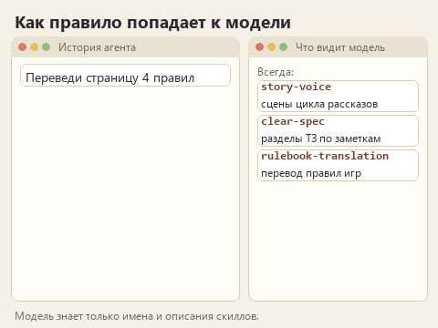
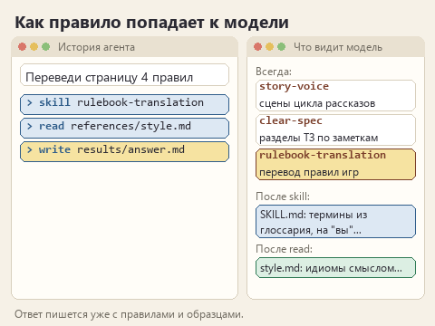

# Как устроен скилл

Возьмём переводчика из [введения](00-introduction.md). У него есть три правила, которые он повторяет модели в каждом диалоге: термины только из глоссария, к игроку на "вы", идиомы смыслом. Можно хранить их в заметке и вставлять в начало каждого запроса. Это работает, пока правил три. Когда к ним добавятся десять пар "как переводить шутки", пример хорошей подсказки и проверка запрещённых слов, запрос превратится в простыню, которую модель читает целиком даже ради одной строки.

Скилл раскладывает эту простыню по местам. Короткое описание видно всегда, основная инструкция загружается, когда задача подходит, а образцы и проверки лежат рядом и подключаются по необходимости.

## Что лежит в папке

Вот папка скилла переводчика в том виде, в каком она будет после шестого урока:

```text
.opencode/
  skills/
    rulebook-translation/
      SKILL.md              <- имя, описание и инструкция
      references/
        style.md            <- образцы: идиомы, подсказки, шутки
      scripts/
        check.js            <- проверка слов не из глоссария
        check.py            <- та же проверка на Python
      assets/
        check.html          <- та же проверка в браузере
```

Обязателен только `SKILL.md`. Он начинается с шапки между двумя строками `---`:

```text
---
name: rulebook-translation
description: "Переводить на русский правила настольных игр издателя: термины по глоссарию, обращение на \"вы\", идиомы смыслом..."
---
```

`name` - техническое имя. Оно должно совпадать с названием папки: этого требует документация OpenCode. `description` объясняет, для каких задач скилл нужен. Кавычки внутри описания экранируются обратной косой чертой, иначе шапка сломается. Ниже шапки идёт обычный текст инструкции, написанный для модели так же, как вы написали бы его коллеге.

## Как инструкция доходит до модели

Сначала приложение находит все папки в `.opencode/skills` и сообщает модели короткий список: имя и описание каждого скилла. Больше модель о них пока ничего не знает. Когда вы просите перевести страницу правил, модель сверяет задачу с описаниями и вызывает инструмент `skill` с именем `rulebook-translation`. Только в этот момент текст `SKILL.md` попадает в разговор.



<details>
<summary>Статичный вариант</summary>



</details>

Справки из `references` сами по себе не загружаются. В инструкции написано, когда их читать: "Перед переводом прочитай стиль издателя". Модель видит ссылку и читает файл обычным инструментом чтения. Если ссылки нет или условие размыто, файл так и пролежит рядом нетронутым. Этот момент мы будем проверять в четвёртом уроке по истории действий агента.

Скрипт тоже не запускается сам. Агент может выполнить `python scripts/check.py results/answer.md` или `node scripts/check.js results/answer.md`, если у него есть доступ к командам и установлен Python или Node.js. Скрипт может быть на любом языке, который есть на компьютере; в курсе их два, чтобы проверку можно было запустить и без Python, в браузере. Скрипт находит строки по списку и печатает отчёт, а модель по этому отчёту правит текст. Решает, верно ли переведено правило, по-прежнему человек.

Такой порядок загрузки описан в [документации OpenCode](https://opencode.ai/docs/skills/). Благодаря ему можно держать в проекте несколько скиллов: модель видит описания всех, а загружает только нужный.

## Чем скилл отличается от длинного промпта

Промпт описывает текущую задачу: "переведи страницу 4". Скилл хранит способ работы, который нужен в каждой похожей задаче: как переводить термины, куда девать незнакомое слово, чего не делать с шутками. Поэтому в уроках мы будем следить, чтобы в скилл не попали подробности одного конкретного текста. Если в инструкции переводчика написано "Keeper переводи как Хранитель", она годится для одной игры. Если написано "термины бери из glossary.csv в папке задания", она годится для любой игры этого издателя.

Описание решает, когда скилл сработает. "Помогает с текстами" подходит под что угодно, и модель начнёт загружать правила перевода в ответ на просьбу поправить ТЗ. "Переводить на русский правила настольных игр" узнаётся точно. В шестом уроке вы проверите это на чужом тексте и допишете в описание, где скилл не нужен.

## Чего скилл не гарантирует

Инструкция направляет модель, но не перепрограммирует её. Одинаковый запрос с одинаковым скиллом может дать разные формулировки, а иногда модель пропустит правило. Поэтому в каждом уроке мы сначала решаем, по каким признакам оцениваем ответ, и только потом отправляем запрос. И поэтому слова агента "я применил скилл" ничего не доказывают: смотреть нужно на действие `skill` в истории работы.

Валидная шапка тоже не делает скилл хорошим. Файл может пройти любую проверку формата и при этом содержать правило "пиши красиво", которое модель поймёт как разрешение добавить три эпитета в каждую фразу.

## Тот же скилл в Codex

В Codex папка проекта называется `.agents/skills`, путь будет `.agents/skills/rulebook-translation/SKILL.md`. Устроен файл так же. Чтобы явно вызвать скилл, в задании пишут `$rulebook-translation`. [Скиллы в Codex](https://developers.openai.com/codex/skills).

## Куда дальше

Если вы ещё не начали практику, переходите к [нулевому уроку](lesson-00-setup.md). Если читаете перед вторым, возвращайтесь к [первому правилу](lesson-02-first-skill.md).
