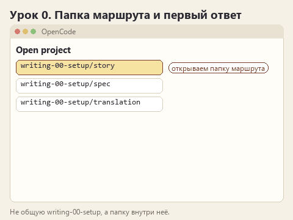
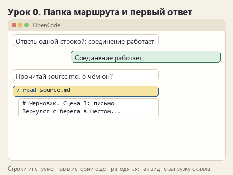

# Урок 0. Ставим OpenCode и выбираем маршрут

[Файлы урока по трём маршрутам](../exercises/writing-00-setup/README.md)

> **Где мы.** Начало курса. Готовим место для опытов: приложение, модель и папку с текстом.
> `папка маршрута -> [OpenCode] -> модель -> первый ответ`

Скилл - это файлы в папке проекта, а читать их будет агент. Нам нужно приложение, которое умеет открывать папку, видеть в ней скиллы и показывать, что агент с ними делает. Таким приложением будет OpenCode Desktop: в нём есть бесплатные модели и подробная история действий агента, по которой мы в каждом уроке будем проверять, что правило действительно загрузилось.

Самое долгое в курсе - этот урок. Дальше будет интереснее.

## Открываем архив

Скачайте [архив урока](../downloads/writing-00-setup.zip?raw=true), откройте его в Проводнике и нажмите "Извлечь всё". Внутри папки `writing-00-setup` три папки маршрутов:

```text
writing-00-setup/
  story/         <- Рассказ: сцена из цикла о смотрителе маяка
  spec/          <- ТЗ: заметки после звонка с пекарнями
  translation/   <- Перевод: страница правил настольной игры
```

Загляните в `source.md` каждой папки и выберите ту, что ближе к вашей работе. В папке маршрута лежат исходный текст `source.md`, факты `facts.md`, признаки хорошего ответа `CHECKLIST.md`, запрос `PROMPT.md`, краткая памятка `TASK.md` и папка `results` для ваших записей.

## Устанавливаем OpenCode

Откройте [страницу загрузки OpenCode](https://opencode.ai/download). Найдите раздел **[2] OpenCode Desktop**, в нём строку **Windows (x64)** и нажмите **Download**. Для обычного ноутбука на Intel или AMD нужен x64; вариант ARM64 предназначен для устройств на ARM. Если не знаете, какой у вас, откройте **Параметры Windows -> Система -> О системе -> Тип системы**.

В Chrome или Edge нажмите **Ctrl+J**, дождитесь файла `opencode-desktop-win-x64.exe` и откройте его. Установите приложение и запустите **OpenCode** из меню "Пуск". Имя файла проверено по официальному релизу v1.19.3 на 21.10.2026; в следующих выпусках оно может измениться. [Официальные релизы](https://github.com/anomalyco/opencode/releases).

## Открываем папку маршрута

В OpenCode нажмите **Open project** и укажите папку своего маршрута, например `writing-00-setup/story`. Встроенный диалог подтверждается кнопкой **Select folder**, системный диалог Windows может называть её "Выбор папки".

Открывайте именно папку маршрута, а не общую `writing-00-setup`. Со второго урока в папке маршрута появится `.opencode/skills`, а OpenCode ищет скиллы внутри той папки, которую вы открыли. Если открыть папку уровнем выше, он их не увидит.

## Выбираем бесплатную модель

Под полем сообщения нажмите на название модели. Откроется окно **Select model** с поиском **Search models**. Найдите раздел **OpenCode Free** или **Free models provided by OpenCode** и выберите модель с пометкой **Free**. В официальном каталоге на дату подготовки курса была, например, GLM-5.3-Flash Free. [Каталог моделей](https://opencode.ai/v2/docs/console/models/).

Для курса лучше подходит модель средней силы. Разница между ответом со скиллом и без него видна там, где модель сама справляется не со всем. Когда автор курса проходил уроки 23.10.2026, MiMo-V2.6-Flash Free почти всё делала правильно и без скилла, North MiniCode Free ошибалась даже со скиллом, а на LFM 2.5 2.6B Free разница была хорошо заметна. Бесплатные предложения меняются, поэтому окончательно силу модели покажет первый урок: там же сказано, что делать, если она окажется слишком сильной или слишком слабой.

Запишите точное название модели в `results/observations.md`. Начиная со второго урока будем работать только с ней: если модель поменяется посередине, мы не поймём, что изменило ответ, она или ваше правило.

Если в списке только платные варианты, откройте **Connect provider** и поищите **OpenCode Free**. Пополнять счёт ради курса не нужно. Бывает, что бесплатный сервис временно недоступен; тогда подождите и попробуйте позже, ваши файлы тут ни при чём.

Подписи кнопок взяты из [исходного кода интерфейса OpenCode](https://github.com/anomalyco/opencode/blob/dev/packages/app/src/runtime/i18n/en.ts). В вашей версии они могут немного отличаться.

## Первый ответ

Введите в поле чата `Ответь одной строкой: соединение работает.` и нажмите Enter. Если пришла строка, всё готово.

Теперь, раз модель на связи, спросите её о вашем тексте, чтобы увидеть, что агент читает файлы папки: `Прочитай source.md и скажи одной фразой, о чём он.` В истории над ответом появится действие чтения файла. Разверните его: так выглядит работа инструмента, и в следующих уроках мы будем искать в истории такие же строки для скилла и справки.



<details>
<summary>Статичный вариант</summary>



</details>

## Чем редактировать файлы

Подойдёт обычный Блокнот: в Проводнике нажмите по файлу правой кнопкой и выберите **Открыть с помощью -> Блокнот**. Сохраняйте через **Ctrl+S** в том же файле. Если пользуетесь VS Code или другим редактором, берите его.
## Готово, если

- OpenCode открыт в папке вашего маршрута, модель ответила одной строкой.
- В истории вы нашли и развернули действие чтения `source.md`.
- В `results/observations.md` записаны маршрут, модель, версия OpenCode и дата.

Следующий урок: [что модель делает без скилла](lesson-01-baseline.md).

Вернуться к [карте курса](00-introduction.md).
