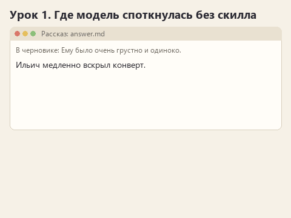
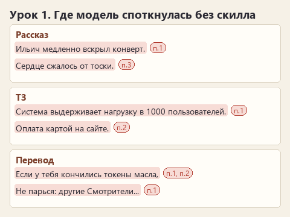

# Урок 1. Что модель делает без скилла

[Файлы урока по трём маршрутам](../exercises/writing-01-baseline/README.md)

> **Где мы.** OpenCode установлен, модель отвечает. Скилла ещё нет: смотрим, что модель сделает с задачей сама.
> `source.md + facts.md -> [модель] -> results/answer.md -> CHECKLIST.md`

Прежде чем учить модель, полезно увидеть, в чём именно её учить. Общая жалоба "пишет как робот" правило не подскажет. А конкретная строка "Ильич медленно вскрыл конверт" в сцене, где письмо по канону остаётся запечатанным, подскажет сразу. Задача этого урока - собрать такие строки.

## Открываем архив

Скачайте [архив урока](../downloads/writing-01-baseline.zip?raw=true), распакуйте и откройте в OpenCode через **Open project** папку своего маршрута: `writing-01-baseline/story`, `spec` или `translation`. Выберите ту же модель, что в нулевом уроке.

## Что лежит перед моделью

Откройте `source.md` и `facts.md` своего маршрута. В каждом тексте спрятано несколько мест, где модель легко ошибиться.

| Маршрут | Исходный текст | На чём модель может споткнуться |
|---|---|---|
| Рассказ | Черновик сцены: смотритель Ильич получает письмо от дочери, кладёт его в ящик стола. Последняя строка - пометка автора "Ему было очень грустно и одиноко" | Канон говорит: письмо не открывается, Ильич молчит, чувства не выражаются словами |
| ТЗ | Заметки после звонка: четыре пекарни, торт от двух дней, предоплата 50%, доставка "может, потом", оплата на сайте не решена | В фактах прямо сказано, чего заказчик не называл и что пока не решено |
| Перевод | Страница правил Lantern Keepers: ход, карты бури, жетоны масла, две английские идиомы | В брифе: термины по `glossary.csv`, обращение на "вы", идиомы смыслом |

Теперь откройте `CHECKLIST.md`. Это шесть признаков, по которым мы будем оценивать каждый ответ до конца курса.

## Угадайте до отправки

Запишите в `results/observations.md`, в строку "Моя догадка до отправки", какие пункты `CHECKLIST.md` модель нарушит. Хотя бы один номер и почему вы так думаете. Например: "Пункт 3: в черновике прямо написано "грустно", модель, скорее всего, оставит это или заменит на "тоска"". После ответа мы к догадке вернёмся.

## Отправляем

В OpenCode нажмите **New session**: новый диалог нужен, чтобы ответ не зависел от разговора в прошлом уроке. Откройте `PROMPT.md` в Блокноте, скопируйте весь текст в чат и отправьте.

В истории работы будет видно, как агент читает `source.md` и `facts.md`, а потом записывает `results/answer.md`. Если у вас уже установлен какой-то писательский скилл глобально и в истории мелькнуло действие `skill`, начните новый диалог и добавьте в начало запроса "Не загружай скиллы". Нам нужен ответ без них.

Статичный вариант

## Разбираем ответ

Откройте `results/answer.md` и пройдите по `CHECKLIST.md` пункт за пунктом. Для каждого нарушения выпишите в `observations.md` саму фразу из ответа. Фраза важнее оценки: именно из неё в следующем уроке вырастет правило.

Вот на что стоит посмотреть особенно внимательно:

- **Рассказ.** Что модель сделала с пометкой "Ему было очень грустно"? Убрала, оставила или раздула в абзац о тоске? Открыто ли письмо? Нет ли у Ильича реплики, хотя бы "Эх, Нина"?
- **ТЗ.** Есть ли в разделе цифры, которых нет в заметках: время ответа, число пользователей, сроки? Где оказались доставка и оплата на сайте - в требованиях или в вопросах? Как описана дата готовности?
- **Перевод.** Как переведены "Oil token" и "Keeper" - по глоссарию? На "вы" или на "ты"? Что стало с "no piece of cake" и "Don't sweat it"? Сколько ходов пропускает игрок без масла?

Вернитесь к догадке. Угадали? Если модель справилась с пунктом, который вы считали трудным, это тоже интересно: запишите и это.

## Если ответ получился хорошим

Так бывает, особенно с сильными моделями. Отправьте тот же `PROMPT.md` ещё раз в новом диалоге. Часто второй ответ нарушает то, что первый соблюдал, и это лучшая иллюстрация того, зачем нужен скилл: правило, которое модель выполняет "обычно", ещё не правило. Если и второй ответ безупречен, запишите оба. Скилл всё равно пригодится, когда вы смените модель или дадите ей текст потруднее.

## Готово, если

- В `results/answer.md` лежит настоящий ответ модели без скилла.
- В `observations.md` есть догадка и хотя бы две конкретные фразы из ответа с номерами пунктов `CHECKLIST.md`.

Предыдущий урок: [ставим OpenCode](lesson-00-setup.md). Следующий: [первое правило в скилле](lesson-02-first-skill.md).

Вернуться к [карте курса](00-introduction.md).
