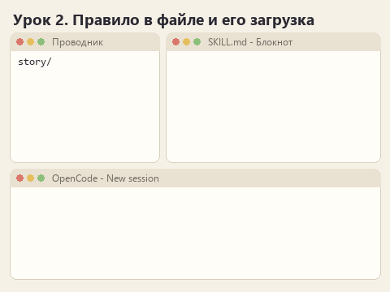
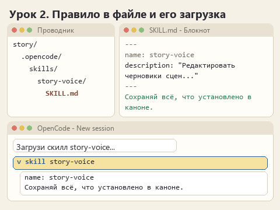

# Урок 2. Первое правило в скилле

[Файлы урока по трём маршрутам](../exercises/writing-02-first-skill/README.md)

> **Где мы.** Есть первый ответ без скилла и список промахов. Переносим одно правило из головы в файл и проверяем, что агент его загружает.
> `SKILL.md -> [инструмент skill] -> правило в разговоре -> ответ`

В прошлом уроке вы видели, как модель ошибается, и, скорее всего, уже сформулировали про себя, что ей нужно было сказать. Сегодня эта фраза переедет в файл. Главное в уроке даже не само правило, а момент, когда оно попадает к модели: его можно увидеть в истории своими глазами.

Если хочется сначала понять устройство папки, прочитайте короткую статью [Как устроен скилл](how-a-skill-works.md).

## Открываем архив

Скачайте [архив урока](../downloads/writing-02-first-skill.zip?raw=true), распакуйте и откройте в OpenCode папку своего маршрута. Модель прежняя.

В папке появилось новое:

```text
story/
  .opencode/
    skills/
      story-voice/
        SKILL.md      <- заготовка, её и заполняем
```

У ТЗ папка скилла называется `clear-spec`, у перевода - `rulebook-translation`.

## Заполняем SKILL.md

Откройте `SKILL.md` в Блокноте. Он выглядит так (на примере рассказа):

```text
---
name: story-voice
description: "Замените это описание: для каких текстов нужен скилл и когда его применять."
---

# Сцены цикла "Маяк на Глухом"

Замените эту строку одним правилом - тем, которое вы повторяли модели чаще всего.
```

Между строками `---` - шапка. `name` не трогайте: имя совпадает с папкой. В `description` напишите своими словами, для каких текстов этот скилл. Пишите так, чтобы модель по одной этой строке поняла, что пора загрузить скилл: назовите вид текста и что с ним делать. Кавычки внутри описания ставьте с обратной косой чертой, `\"вот так\"`, или обходитесь без них.

Ниже заголовка замените строку-подсказку одним правилом. Возьмите его из своих наблюдений прошлого урока: что вам больше всего хотелось сказать модели, когда вы читали ответ? Одно правило, одна-две фразы. Остальные придут в следующих уроках.

<details>
<summary>Моя версия для маршрута &quot;Рассказ&quot;</summary>

description: "Редактировать черновики сцен цикла рассказов \"Маяк на Глухом\": превращать заметки автора в чистовой текст в стиле цикла, не нарушая канон."

Правило: Переписывай черновик сцены в чистовой текст так, чтобы сохранилось всё, что установлено в каноне: события, время, место и то, что герой уже знает.

</details>

<details>
<summary>Моя версия для маршрута &quot;ТЗ&quot;</summary>

description: "Составлять и править разделы технического задания по заметкам со встреч с заказчиком: проверяемые требования для разработчика и список открытых вопросов."

Правило: Пиши требования для разработчика, который не был на встречах с заказчиком. Опирайся только на то, что заказчик подтвердил.

</details>

<details>
<summary>Моя версия для маршрута &quot;Перевод&quot;</summary>

description: "Переводить на русский правила настольных игр издателя: термины по глоссарию, обращение на \"вы\", идиомы смыслом, игровые правила без изменений."

Правило: Переводи правила настольных игр на русский так, чтобы по переводу можно было сыграть точно так же, как по оригиналу. Смысл правила важнее близости к словам.

</details>

Сохраните файл через **Ctrl+S**.

## Отправляем и ищем загрузку

В OpenCode создайте **New session**. OpenCode ищет скиллы в момент, когда открывается диалог, поэтому после каждой правки `SKILL.md` начинайте новый. Откройте `PROMPT.md`: по сравнению с прошлым уроком в нём добавилась одна первая строка, "Загрузи скилл ... через инструмент skill". Скопируйте текст в чат и отправьте.

Теперь самое интересное. В истории работы найдите строку с инструментом `skill` и разверните её. Внутри должен быть текст вашего `SKILL.md`, с вашим правилом: в этот момент оно попало к модели.



<details>
<summary>Статичный вариант</summary>



</details>

Если строки `skill` нет, а агент пишет "я применил скилл", не верьте на слово: загрузки не было. Если вместо `skill` агент открыл `SKILL.md` обычным чтением файла, правило он увидел, но механизм скиллов мы так и не проверили. Запишите, что именно видно в истории.

## Если OpenCode не видит скилл

Проверьте по порядку:

1. В OpenCode открыта папка маршрута, а не папка уровнем выше.
2. Путь точно такой: `.opencode/skills/<имя>/SKILL.md`, имя файла заглавными буквами.
3. Файл называется `SKILL.md`, а не `SKILL.md.txt`. В Проводнике включите **Вид -> Показать -> Расширения имён файлов**, чтобы это увидеть.
4. Шапка начинается с `---` в самой первой строке, `name` совпадает с названием папки.
5. После сохранения создан новый диалог.

Дописывать правила, пока скилл не загружается, бесполезно: модель их не увидит.

## Попробуйте сломать

Поменяйте в шапке `name: story-voice` на `name: story-voice-2`, сохраните и откройте новый диалог. Попросите: `Какие скиллы тебе доступны?` Посмотрите, что ответит агент и появится ли скилл в списке. Затем верните прежнее имя. Теперь вы знаете, как выглядит самая частая поломка, и узнаете её сразу.

## Сравниваем с первым ответом

Откройте новый `results/answer.md` и свой ответ из прошлого урока (он остался в папке `writing-01-baseline`). Пройдите оба по `CHECKLIST.md`. Одно общее правило редко исправляет всё. Запишите, какие пункты изменились, а какие нет: оставшиеся промахи станут материалом для третьего урока.

## Готово, если

- В истории есть развёрнутое действие `skill` с текстом вашего `SKILL.md`.
- В `observations.md` записано, какое правило вы добавили и что изменилось по `CHECKLIST.md`.

Предыдущий урок: [что модель делает без скилла](lesson-01-baseline.md). Следующий: [правило, которое можно проверить](lesson-03-checkable-rule.md).

Вернуться к [карте курса](00-introduction.md).
