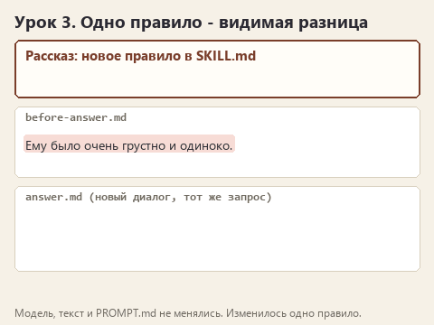
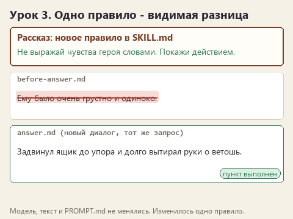

# Урок 3. Правило, которое можно проверить

[Файлы урока по трём маршрутам](../exercises/writing-03-reader-context/README.md)

> **Где мы.** Скилл загружается и содержит одно общее правило. Добавляем второе, точное, и впервые ставим честный опыт "до и после".
> `ответ до -> [одно новое правило] -> ответ после -> сравнение по CHECKLIST.md`

Попросите модель "писать живо", и она добавит прилагательных. Попросите "писать чётко", и она разобьёт текст на пункты. Пожелание каждый понимает по-своему, и модель не исключение. Правило работает, когда в нём сказано, что делать в конкретной ситуации и как потом проверить, что это сделано.

Сравните две строки для сцены:

- "Пиши выразительно и эмоционально".
- "Не выражай чувства героя словами. Покажи, что он делает, на что смотрит, где медлит".

По первой нельзя проверить ответ: эмоционально - это сколько? По второй можно: ищем в тексте "грустно", "тоска", "сердце сжалось". Нашли - правило не сработало.

## Открываем архив

Скачайте [архив урока](../downloads/writing-03-reader-context.zip?raw=true), распакуйте и откройте в OpenCode папку своего маршрута. В `SKILL.md` уже заполнены описание и первое правило, а ниже стоит строка-подсказка для сегодняшнего правила.

## Сначала ответ "до"

Чтобы сравнение было честным, ответ "до" получим здесь же, с тем же скиллом, только без нового правила. Создайте **New session**, отправьте `PROMPT.md`. Когда появится `results/answer.md`, скопируйте его в Проводнике и переименуйте копию в `before-answer.md`.

Подробнее о том, почему так, написано в статье [Как ставить опыт с моделью](experiments.md).

## Пишем правило

Откройте `SKILL.md` и замените строку-подсказку своим правилом. Хорошее правило отвечает на три вопроса: в какой ситуации оно действует, что модель делает и по какому признаку вы увидите результат. Ищите материал в своих наблюдениях: самые частые промахи по `CHECKLIST.md`.

| Маршрут | О чём правило | Признак, по которому проверим |
|---|---|---|
| Рассказ | Что делать, когда чувство выражено словами, и почему нельзя забегать вперёд сюжета | В тексте нет "грустно" и "тоска"; письмо не открыто |
| ТЗ | Как выглядит проверяемое требование и куда девать то, чего заказчик не говорил | У каждого требования есть проверка; доставка и оплата стоят в открытых вопросах |
| Перевод | Откуда брать термины, что делать с незнакомым термином, как обращаться к игроку | Все компоненты по глоссарию; везде "вы" |

Избегайте названий конкретных строк текста в правиле. "Не пиши, что Ильич открыл письмо" сработает только для этой сцены. "Герой знает и делает только то, что есть в черновике" сработает и в следующей.

Моя версия для маршрута &quot;Рассказ&quot;

Не выражай чувства героя словами. Вместо "ему было грустно" покажи, что он делает, на что смотрит, где медлит. Если в черновике чувство выражено словами, это пометка автора для тебя: найди для неё действие или предмет из этой же сцены.
Не забегай вперёд сюжета: герой знает и делает только то, что есть в черновике.

Моя версия для маршрута &quot;ТЗ&quot;

Каждое требование записывай так, чтобы его можно было проверить на тестовом заказе: кто действует, при каком условии и что должно получиться.
Чего нет среди подтверждённых фактов, не придумывай. Вынеси это в раздел "Открытые вопросы": что спросить и у кого.

Моя версия для маршрута &quot;Перевод&quot;

Названия компонентов бери только из glossary.csv в папке задания. Если термина в глоссарии нет, оставь английское слово в квадратных скобках и добавь вопрос редактору в конце перевода.
К игроку обращайся на "вы", действия пиши повелительным наклонением.

Сохраните файл. Больше ничего не меняйте: ни `PROMPT.md`, ни модель, ни исходный текст.

## Угадайте до отправки

Запишите в `observations.md`, какой пункт `CHECKLIST.md` должен исправиться благодаря правилу, а какой, по-вашему, останется как был. Новое правило не обязано чинить всё.

## Отправляем "после"

Создайте **New session**, отправьте тот же `PROMPT.md`. В истории разверните `skill` и убедитесь, что новое правило там есть. Затем откройте рядом `before-answer.md` и новый `answer.md`.

Статичный вариант

Найдите место, которое правило должно было изменить. У рассказа это строка про грусть, у ТЗ - цифры и нерешённые вопросы, у перевода - жетоны и обращение. Выпишите фразу "до" и фразу "после" в `observations.md`.

Отправьте запрос ещё раз в новом диалоге. Если правило сработало оба раза, это уже похоже на результат. Если один раз из двух, правило нужно уточнить: обычно не хватает признака или ситуации, в которой оно действует.

## Попробуйте сломать

Замените своё правило размытым пожеланием, например "Пиши выразительно" для рассказа, "Пиши требования качественно" для ТЗ или "Переводи грамотно" для перевода. Новый диалог, тот же запрос. Сравните с ответом по точному правилу. Обычно разница заметна сразу, и после этого опыта вас уже не потянет писать в скилл "пиши хорошо". Верните точное правило.

## Готово, если

- Есть `before-answer.md` и `answer.md`, которые отличаются только новым правилом.
- В `observations.md` выписаны фразы "до" и "после" с номером пункта `CHECKLIST.md`.

Предыдущий урок: [первое правило в скилле](lesson-02-first-skill.md). Следующий: [справка, которую агент читает сам](lesson-04-references.md).

Вернуться к [карте курса](00-introduction.md).
