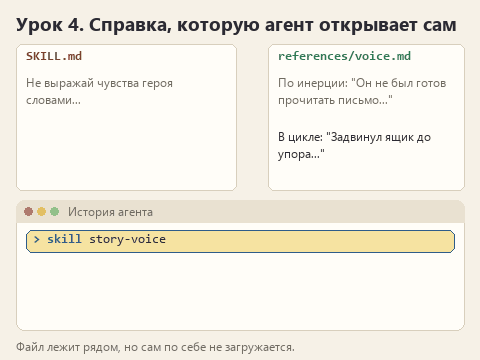
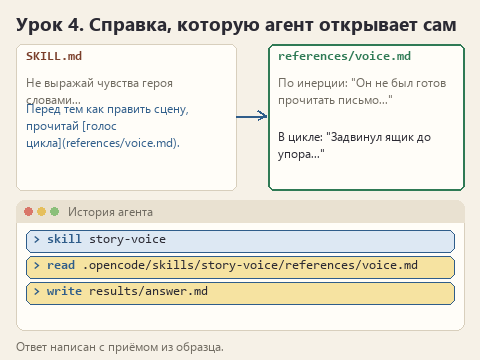

# Урок 4. Справка, которую агент читает сам

[Файлы урока по трём маршрутам](../exercises/writing-04-references/README.md)

> **Где мы.** В скилле два правила, и модель их выполняет. Добавляем образцы: не в SKILL.md, а в отдельный файл рядом.
> `SKILL.md -> [ссылка и условие] -> references/... -> ответ`

Правило говорит, что делать. Образец показывает, как это выглядит. Модель гораздо лучше понимает "не выражай чувства словами", когда рядом лежит пара: вот так пишут по инерции, а вот так звучит в цикле. Проблема в том, что образцов со временем становится много. Через месяц у автора рассказов их будет двадцать, у переводчика - пятьдесят идиом. Если всё это держать в `SKILL.md`, модель будет читать пятьдесят идиом даже ради задачи, где идиом нет.

Поэтому образцы кладут в отдельный файл в папке `references`, а в `SKILL.md` пишут, когда его открыть. Сегодня проверим, что агент действительно его открывает.

## Открываем архив

Скачайте [архив урока](../downloads/writing-04-references.zip?raw=true), распакуйте и откройте в OpenCode папку своего маршрута. В папке скилла появилась `references`:

| Маршрут | Файл справки | Что в нём |
|---|---|---|
| Рассказ | `references/voice.md` | Пары "по инерции / в цикле": чувство через действие, пейзаж одной фразой, предмет вместо объяснения |
| ТЗ | `references/requirements.md` | Форма проверяемого требования и пары "было / стало" из других проектов |
| Перевод | `references/style.md` | Пары "оригинал / дословно / у нас": идиома, подсказка, разговорная фраза |

## Дописываем образец

Откройте справку в Блокноте. Последняя пара в ней не закончена, допишите её сами. Это хороший момент почувствовать себя автором: образец задаёт тон точнее любого правила.

- **Рассказ.** Строка черновика "Убрал в ящик стола". По инерции модель напишет "Он не был готов прочитать письмо и решил отложить его". Как это звучит в цикле, через действие или предмет?
- **ТЗ.** "Система не даёт ошибиться с датой". Напишите требование про дату готовности вместе с проверкой на тестовом заказе.
- **Перевод.** "Don't sweat it", дословно "Не потей". Как сказать это в правилах для семейной игры?

Мои версии

Рассказ: "Задвинул ящик до упора, потом проверил, закрылся ли".

ТЗ: "Когда клиент выбирает дату готовности, календарь не даёт выбрать день раньше чем через два дня от сегодняшнего. Проверка: в понедельник попробовать выбрать вторник - день недоступен; среда доступна".

Перевод: "Не беда".

## Пишем в SKILL.md, когда читать справку

В `SKILL.md` замените строку-подсказку указанием: когда открыть справку и зачем. Ссылку пишите так: `[голос цикла](references/voice.md)`. В квадратных скобках название, в круглых путь от папки скилла.

Слово "когда" здесь главное. "Используй справку" не говорит модели, в какой момент это нужно, и она может решить, что справка не к спеху. "Перед тем как писать или править сцену, прочитай `[голос цикла](references/voice.md)`" называет момент.

Моя версия для маршрута &quot;Рассказ&quot;

Перед тем как писать или править сцену, прочитай `[голос цикла](references/voice.md)`. Бери оттуда приём, а не готовые фразы.

Моя версия для маршрута &quot;ТЗ&quot;

Перед тем как писать требования, прочитай `[примеры требований](references/requirements.md)`. Бери оттуда форму, а не содержание: примеры не про этого заказчика.

Моя версия для маршрута &quot;Перевод&quot;

Перед переводом прочитай `[стиль издателя](references/style.md)`: как передавать идиомы, подсказки и шутки. Переноси приём, фразы подбирай под текст.

Вторая фраза в каждой версии тоже не случайна. Без неё модель может вставить образец в ответ целиком: смотритель Ильич дважды задвинет ящик в каждой сцене, а в ТЗ пекарни появится поиск по каталогу.

## Угадайте до отправки

Сколько действий с файлами скилла вы увидите в истории? Запишите число.

## Отправляем и ищем второе действие

Новый диалог, тот же `PROMPT.md`. В истории должно быть два разных действия: `skill` с текстом `SKILL.md` и чтение файла `references/...`. Разверните второе и убедитесь, что там ваш дописанный образец.

Статичный вариант

Если чтения справки нет, проверьте путь в ссылке и само условие. Файл может лежать на месте, но если в инструкции не сказано, когда его читать, агент вправе обойтись без него. После исправления снова начните новый диалог. Как OpenCode обращается со справками, описано в [документации](https://opencode.ai/v2/docs/skills/).

Затем пройдите ответ по `CHECKLIST.md`. Сам вынос в отдельный файл текст не улучшает, зато видно, перенесла ли модель приём из образца. Ищите в ответе место, похожее по устройству на вашу пару, но со своими словами.

## Попробуйте сломать

Сделайте опечатку в пути, например `references/voise.md`. Новый диалог, тот же запрос. Что сделает агент: сообщит об ошибке, поищет похожий файл или молча обойдётся без справки? Запишите. Потом исправьте путь.

## Готово, если

- Образец дописан, в `SKILL.md` есть ссылка на справку и условие, когда её читать.
- В истории видны два действия: загрузка скилла и чтение справки.

Предыдущий урок: [правило, которое можно проверить](lesson-03-checkable-rule.md). Следующий: [что ловит скрипт и что ловите вы](lesson-05-checks.md).

Вернуться к [карте курса](00-introduction.md).
