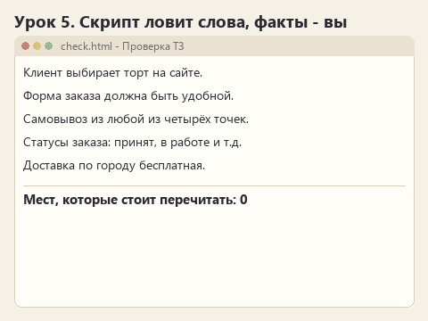
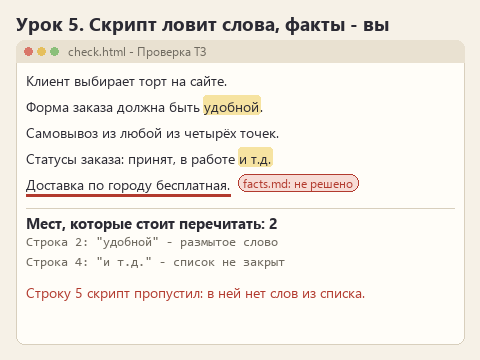

# Урок 5. Что ловит скрипт и что ловите вы

[Файлы урока по трём маршрутам](../exercises/writing-05-checks/README.md)

> **Где мы.** У скилла есть правила и справка с образцами. Добавляем третью часть - программу, которая проверяет ответ одинаково каждый раз.
> `results/answer.md -> [scripts/check.js] -> список мест -> решение человека`

Часть промахов можно найти механически. Слово "токен" в переводе правил либо есть, либо нет. "И т.д." в ТЗ либо стоит, либо нет. Для таких вещей не нужен вкус, нужен список, и программа пройдёт по нему без усталости, в десятый раз так же внимательно, как в первый.

Другая часть промахов списком не ловится. Фраза "Ильич вскрыл конверт" не содержит ни одного запретного слова, но ломает сюжет всего цикла. Сегодня мы разделим эти две части и запишем в скилл, кто за какую отвечает.

## Открываем архив

Скачайте [архив урока](../downloads/writing-05-checks.zip?raw=true), распакуйте и откройте в OpenCode папку своего маршрута. Нового стало четыре файла:

```text
story/
  check.html                        <- страница проверки, открывается в браузере
  .opencode/skills/story-voice/
    scripts/check.js                <- сама проверка
    scripts/check.py                <- та же проверка на Python
    assets/check.html               <- такая же страница внутри скилла
```

Обе страницы используют один и тот же `check.js`. В `check.py` тот же список, записанный на Python: он понадобится в необязательном разделе в конце урока. Писать код не нужно, всё готово.

## Получаем свежий ответ

Создайте **New session** и отправьте `PROMPT.md`. Скилл в архиве такой, каким он стал после прошлого урока, так что в `results/answer.md` появится ответ с правилами и справкой. Его и будем проверять.

## Проверяем в браузере

Дважды щёлкните по `check.html` в папке маршрута. Страница откроется в браузере. Нажмите кнопку выбора файла, укажите `results/answer.md` и нажмите **Проверить**. Под кнопкой появится список строк с подсказками.

| Маршрут | Что ищет скрипт |
|---|---|
| Рассказ | Чувства, выраженные словами, затёртые обороты вроде "сердце сжалось", пейзажные штампы, слова не из 1974 года |
| ТЗ | Размытые слова: "быстро", "удобно", "оптимально", незакрытые списки "и т.д.", оговорки "при необходимости" |
| Перевод | Термины мимо глоссария: "токен", "фишка", "смотритель", "шторм"; обращение на "ты"; дословные идиомы |



<details>
<summary>Статичный вариант</summary>



</details>

Каждую находку перечитайте. Не всё отмеченное - ошибка: "быстро" может стоять в цитате заказчика, "ты" - в реплике персонажа. Скрипт показывает, куда посмотреть, а решаете вы.

## Ошибка, которую скрипт не видит

Очистите поле на странице и вставьте одну фразу своего маршрута:

- **Рассказ:** `Ильич вскрыл конверт и узнал почерк Нины.`
- **ТЗ:** `Доставка по городу бесплатная.`
- **Перевод:** `Если масло закончилось, пропустите два следующих хода.`

Угадайте до нажатия: сколько находок покажет скрипт? Нажмите **Проверить**. Ноль. А фраза ломает факты: письмо по канону не открывается, доставку заказчик не решил, а пропускается один ход, а не два. Сверить это может только тот, кто прочитал `facts.md` или оригинал.

## Записываем в скилл, кто что проверяет

В `SKILL.md` замените строку-подсказку правилом о проверке. В нём стоит сказать три вещи: когда запускать проверку, что делать с находками и что скрипт не проверяет.

<details>
<summary>Моя версия для маршрута &quot;Рассказ&quot;</summary>

Когда сцена готова, запусти проверку из папки скилла с путём к результату: scripts/check.py, если доступен Python, или scripts/check.js, если доступен Node.js. Если запустить нечем, попроси человека проверить текст страницей check.html и разбери его отчёт. Каждую находку перечитай и реши сам: скрипт подсказывает, а не запрещает. Сюжет и канон он не знает, их сверяй по facts.md.

</details>

<details>
<summary>Моя версия для маршрута &quot;ТЗ&quot;</summary>

Когда раздел готов, запусти проверку из папки скилла с путём к результату: scripts/check.py, если доступен Python, или scripts/check.js, если доступен Node.js. Если запустить нечем, попроси человека проверить текст страницей check.html и разбери его отчёт. Каждую находку перечитай и реши сам: иногда слово "быстро" стоит в цитате заказчика. Скрипт не знает фактов: придуманные решения и цифры сверяй по facts.md.

</details>

<details>
<summary>Моя версия для маршрута &quot;Перевод&quot;</summary>

Когда перевод готов, запусти проверку из папки скилла с путём к результату: scripts/check.py, если доступен Python, или scripts/check.js, если доступен Node.js. Если запустить нечем, попроси человека проверить текст страницей check.html и разбери его отчёт. Каждую находку перечитай: "ты" может стоять в реплике персонажа. Смысл правил скрипт не знает, его сверяй с оригиналом построчно.

</details>

Ни Python, ни Node.js для курса не обязательны. Если один из них установлен, агент запустит проверку сам, и в истории вы увидите команду и её вывод; как это выглядит с Python, разобрано в конце урока. Если нет, проверяйте страницей и вставляйте её отчёт в чат: `Вот отчёт проверки, поправь отмеченные места, сверяясь с facts.md`. Агент не должен писать, что запускал скрипт, если команды в истории нет.

Новый диалог, тот же `PROMPT.md`. Посмотрите, что изменилось: запустил ли агент проверку, исправил ли находки, написал ли, что факты сверил сам.

## Допишите свой шаблон

Откройте `scripts/check.js` в Блокноте. В начале файла есть список `PATTERNS`. Каждая строка - пара: начало слова или оборот и подсказка:

```text
  [
    "грустн|печал|тоск|одинок|скучал по",
    "чувство выражено словами - покажите его действием"
  ],
```

Вертикальная черта значит "или". Скрипт ищет слова, которые начинаются с указанного: `грустн` найдёт и "грустно", и "грустный". Добавьте свою пару после любой закрывающей `],`, например `["вдруг", "проверьте, нужно ли тут \"вдруг\""],` для рассказа, `["гибк", "что именно должно меняться?"],` для ТЗ или `["игрок может", "в правилах пишем действие: \"возьмите\""],` для перевода. Сохраните, обновите страницу в браузере через **F5** и проверьте текст, где есть это слово. Если страница перестала работать, скорее всего, пропала запятая или кавычка: сравните свою строку с соседними.

В `scripts/check.py` тот же список записан по правилам Python: каждая пара в круглых скобках, `("вдруг", "проверьте, нужно ли тут \"вдруг\""),`. Если будете проходить раздел про Python, добавьте свою пару и туда.

## Необязательно: проверку запускает агент на Python

Страницу в браузере открываете вы, а агент её открыть не может. Чтобы агент проверял текст сам и тут же исправлял найденное, ему нужна программа, которую можно запустить командой. Для этого в папке скилла лежит `check.py`.

### Когда скилл подкрепляют Python-скриптом

Скрипт в скилле нужен там, где проверку можно записать правилом для программы и её нужно повторять одинаково каждый раз. В длинном тексте модель может пропустить одного "смотрителя" среди "Хранителей", а программа, идущая по списку, его не пропустит. Python выбирают, когда:

- **агент должен проверять сам**, без человека: запустить, прочитать вывод, поправить текст и запустить снова;
- **проверка работает с файлами и данными.** Переводчику удобнее, чтобы скрипт сам читал `glossary.csv` и сверял каждый термин, а не хранил копию списка внутри себя. Аналитику - чтобы скрипт сравнивал раздел ТЗ с таблицей требований в Excel. В Python для этого есть готовые средства: модуль `csv` встроен, для Excel есть библиотека `openpyxl`;
- **проверка сложнее поиска по словам**: посчитать длину реплик, найти повторы, сверить числа в двух файлах.

То, что нельзя записать правилом для программы, остаётся в `SKILL.md` и на вашей совести. "Не забегай вперёд сюжета" или "доставка не решена" скрипт не проверит.

Страница на JavaScript в этом курсе нужна для тех, у кого Python нет: она работает в любом браузере без установки. В своём скилле обычно выбирают что-то одно. Почему - увидите в опыте ниже.

### Есть ли Python

В OpenCode создайте **New session** и напишите: `Выполни команду python --version и покажи вывод.` Если OpenCode спросит разрешение на запуск команды, разрешите. Ответ вида `Python 3.12.4` значит, что можно продолжать. Если команда не найдена или Windows предлагает открыть Microsoft Store, Python не установлен; этот раздел можно пропустить, основная часть урока от него не зависит.

### Агент запускает проверку сам

Правило о проверке в `SKILL.md` уже называет `scripts/check.py` (если вы писали своё правило, допишите туда этот скрипт). Угадайте до отправки: запустит ли агент проверку сам, если в запросе о ней ни слова?

Создайте **New session** и отправьте обычный `PROMPT.md`. В истории ищите действие запуска команды, примерно такое:

```text
python .opencode/skills/story-voice/scripts/check.py results/answer.md
```

Разверните его. В выводе те же строки, что показывала страница: номер строки, найденное слово и подсказка, а в конце `Мест, которые стоит перечитать: ...`. Дальше агент должен поправить отмеченные места и, если хватит лимита действий, запустить проверку ещё раз. Сравните итоговый `results/answer.md` с первым ответом урока.

Если агент проверку не запустил, допишите в конец запроса: `После записи ответа запусти проверку scripts/check.py из папки скилла и поправь найденные места, сверяясь с facts.md.` Запишите в `observations.md`, понадобилась ли эта строка: так видно, хватает ли одного правила в скилле.

### Попробуйте сломать

Добавьте новую пару только в `check.js`, а в `check.py` не добавляйте. Вставьте на страницу и в ответ фразу с этим словом. Страница его найдёт, агент со своим `check.py` - нет. Один список в двух местах рано или поздно разойдётся, поэтому в настоящем скилле проверку держат в одном скрипте. Верните файлы в согласованное состояние.

## Готово, если

- Страница проверки показала находки в ответе, а фразу с ошибкой в фактах пропустила.
- В `SKILL.md` записано, когда запускать проверку и что остаётся человеку.
- В `PATTERNS` есть ваша собственная пара.
- Необязательно: в истории видно, как агент сам запустил `check.py` и поправил найденное.

Предыдущий урок: [справка, которую агент читает сам](lesson-04-references.md). Следующий: [новый текст, чужой текст и другой проект](lesson-06-transfer.md).

Вернуться к [карте курса](00-introduction.md).
