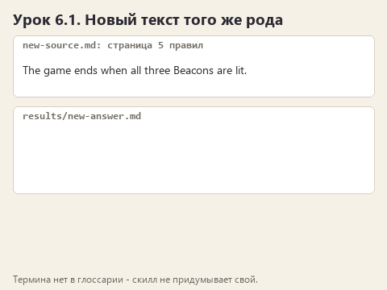
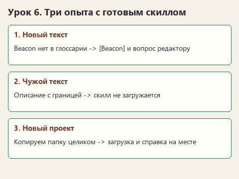

# Урок 6. Новый текст, чужой текст и другой проект

[Файлы урока по трём маршрутам](../exercises/writing-06-transfer/README.md)

> **Где мы.** Скилл собран: правила, справка, проверка. Пять уроков он работал с одним и тем же текстом. Пора выпустить его наружу.
> `новый текст -> скилл -> ответ`, `чужой текст -> скилл не нужен`, `папка скилла -> новый проект`

Скилл, который хорошо правит одну сцену, ещё может оказаться заточенным под неё. Если в правилах проскочило "Ильич не говорит ни слова", то в сцене, где Ильич говорит по рации, скилл заставит его молчать. Если описание слишком общее, скилл переводчика полезет в ТЗ. Сегодня три опыта, и каждый проверяет одну из этих опасностей.

## Открываем архив

Скачайте [архив урока](../downloads/writing-06-transfer.zip?raw=true), распакуйте и откройте в OpenCode папку своего маршрута. Скилл в ней полный: все правила, справка и проверка из прошлых уроков. Появились новые файлы:

| Файл | Что в нём |
|---|---|
| `new-source.md`, `new-facts.md` | Новый текст того же рода со своими фактами |
| `NEW-PROMPT.md` | Запрос для нового текста |
| `neighbor-source.md` | Текст из чужого маршрута |
| `NEIGHBOR-PROMPT.md` | Запрос "приведи текст в порядок" без названия скилла |

## Опыт 1. Новый текст того же рода

| Маршрут | Новый текст | Чем он отличается |
|---|---|---|
| Рассказ | Сцена 4: вечерний сеанс рации, радист Коля передаёт, что в Архангельске ждут ответа на письмо | Ильич здесь говорит, но только служебными фразами связи |
| ТЗ | Заметки после звонка со студией йоги: онлайн-запись, не больше 12 человек в группе, отмена за 4 часа | Другой заказчик и другие нерешённые вопросы |
| Перевод | Страница 5 правил: конец игры, подсчёт масла, ничья | Термина Beacon нет в глоссарии |

Угадайте до отправки, где скилл может подвести. Подсказка: перечитайте свои правила и найдите в них хоть одну подробность прошлого текста.

Новый диалог, текст из `NEW-PROMPT.md`. Ответ появится в `results/new-answer.md`. Проверяйте по `new-facts.md`:

- **Рассказ.** Говорит ли Ильич? Должен, но только "Принял", "Конец связи" и похожее. Если он молчит всю сцену, в скилл попал факт сцены 3. Открыто ли письмо? Названы ли "стыд" и "страх" из пометки автора?
- **ТЗ.** Нет ли в разделе пекарен, тортов, предоплаты? Попала ли продажа абонементов в открытые вопросы с адресатом "директор студии"?
- **Перевод.** Что стало с Beacon? По правилу урока 3 слово должно остаться в квадратных скобках с вопросом редактору. Если модель придумала "маяк" или "сигнальный огонь", правило про незнакомые термины надо усилить.

Если в ответ протекли факты старого текста, найдите в `SKILL.md` или справке фразу, которая их принесла, и перепишите её как общий приём. Повторите опыт в новом диалоге.

## Опыт 2. Чужой текст

Скилл не должен включаться там, где он не нужен. Проверим это. В `neighbor-source.md` лежит текст из другого маршрута: у рассказа это заметки про пекарни, у ТЗ и перевода - черновик сцены с маяком.

Угадайте до отправки: загрузит ли агент ваш скилл?

Новый диалог, текст из `NEIGHBOR-PROMPT.md`. В нём нет названия скилла, агент выбирает сам по описаниям. Посмотрите в историю: есть ли действие `skill`? Если есть, откройте `results/neighbor-answer.md`. Скорее всего, там видно, как правила одного жанра испортили другой: заметки пекарни, переписанные "чувство через действие", или сцена, разбитая на требования с проверками.

Статичный вариант

Если агент скилл не загрузил, описание уже достаточно точное. Если загрузил, допишите границу. В `description` добавьте в конец фразу о том, где скилл не применять, и продублируйте её последним абзацем инструкции.

Мои версии границ

Рассказ: "Не применять к деловым документам, техническим заданиям и переводам."

ТЗ: "Не применять к художественным текстам и переводам."

Перевод: "Не применять к русским текстам, которые не нужно переводить."

Повторите опыт с чужим текстом в новом диалоге. Модели не всегда слушаются границ с первого раза; если скилл снова загрузился, сделайте описание точнее в его основной части: назовите вид текста конкретнее.

## Опыт 3. Другой проект

Скилл - это папка, и переносится он копированием папки. Проверим, что всё нужное лежит внутри неё.

1. Рядом с распакованным архивом создайте в Проводнике папку `my-skill-check`.
2. В ней создайте `.opencode`, внутри `skills`.
3. Скопируйте туда папку своего скилла целиком: `story-voice`, `clear-spec` или `rulebook-translation`, вместе с `references`, `scripts` и `assets`.
4. В корень `my-skill-check` скопируйте `new-source.md`, `new-facts.md`, `NEW-PROMPT.md`, а для перевода ещё `glossary.csv`. Создайте пустую папку `results`.
5. Откройте `my-skill-check` в OpenCode через **Open project**, выберите прежнюю модель и отправьте `NEW-PROMPT.md`.

В истории должны быть загрузка скилла и чтение справки, как в старой папке. Если справка не нашлась, значит, при копировании потерялась вложенная папка. `results`, `facts.md`, `CHECKLIST.md` и ваши заметки к скиллу не относятся и в папку скилла не попадают: это материалы задания, а скилл - способ работы с ними.

## Итог в одной схеме

Запишите в `observations.md` своими словами путь правила: где лежит файл, когда агент его загружает, когда читает справку, кто запускает проверку и что вы проверяете сами. Если можете рассказать это без подглядывания в уроки, курс пройден.

## Готово, если

- Новый текст обработан без фактов старого.
- На чужом тексте скилл не загружается или вы дописали границу и проверили её ещё раз.
- В `my-skill-check` скилл загружается и читает свою справку.

Предыдущий урок: [что ловит скрипт и что ловите вы](lesson-05-checks.md). Дальше: [заключение](conclusion.md).

Вернуться к [карте курса](00-introduction.md).
